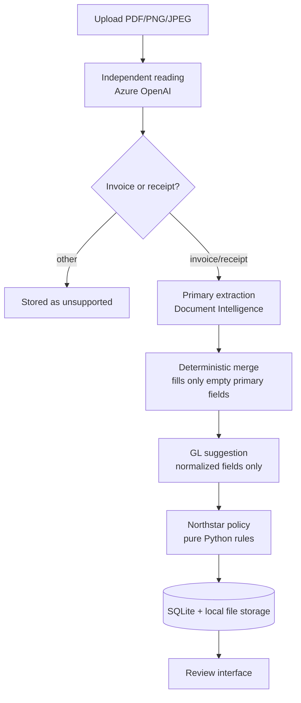
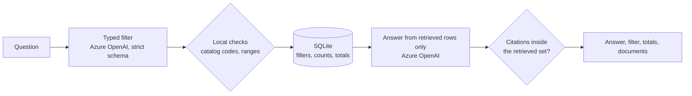
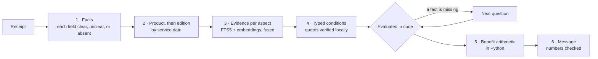

# Invoice Review

An end-to-end review workstation for supplier invoices and expense receipts, built for Northstar Facilities B.V. — a fictional Amsterdam facilities-management company whose documents arrive as PDFs, scans, screenshots, and phone photos in English, Dutch, German, or French.

Upload one document. The application recognizes what it is, extracts it twice through two independent Azure services, merges the readings deterministically, checks it against the company's finance rules, suggests a general-ledger account, and hands a finance administrator a prepared review to approve, reject, or turn into a supplier correction request.

> This repository started as a course starter containing only configuration, documentation, lockfiles, and the sample corpus — no application code. Everything under `backend/app`, `backend/scripts`, and `frontend/src` is my own build.

## The idea

A single extraction service is confidently wrong often enough to matter, and you cannot tell when from its output alone. So this application reads every document twice:

- **Azure AI Document Intelligence** (`prebuilt-invoice` / `prebuilt-receipt`) is the primary reader and stays authoritative.
- **Azure OpenAI** reads the same original file independently and produces the same normalized shape.

A deterministic merge keeps every Document Intelligence value and fills **only** its empty fields from the model. A model value can never overwrite a conflicting primary value, validate a VAT number, or decide an approval. Every field carries its provenance, so the reviewer sees exactly where each value came from and where the two readers disagreed.

Measured over the 13-document corpus:

| Run | Field accuracy | Exact documents | Policy matches | Provider failures |
| --- | ---: | ---: | ---: | ---: |
| Document Intelligence only | 168/169 — 99.4% | 12/13 | 12/13 | 0/13 |
| Hybrid (DI + independent reading) | **169/169 — 100%** | **13/13** | **13/13** | 0/13 |

The single DI-only miss is real, not synthetic: on `05-nl-missing-vendor-vat.pdf` Document Intelligence returns no `purchase_order` even though the document shows PO-4005, which then raises a spurious `purchase_order_missing` warning. The independent reading fills that exact field. `amount_due` needed the fallback on 10 of 12 invoices. That gap is the entire argument for the second reader.

## What it does

- One PDF, PNG, or JPEG per upload, 4 MB limit, type detected from the file's leading bytes rather than its name.
- Automatic invoice/receipt/other classification with strict structured output.
- Invoice supplier and customer identity, VAT IDs, dates, purchase order, currency, and totals; receipt merchant, transaction date, expense category, subtotal, VAT, and total.
- Offline EU VAT format and checksum validation via `python-stdnum` — no live VIES lookup, and the app never claims one.
- Separate deterministic invoice and receipt policies, plus duplicate detection by both exact file content and vendor/invoice-number key.
- A fixed Northstar GL catalog with a model suggestion the reviewer can override; the human owns the selection.
- Field-level corrections that atomically revalidate, with human edits marked as such and protected from re-flagging.
- Approve or reject with a final read-only state, guarded by optimistic revision checks so two tabs cannot race.
- An on-demand correction-email draft for supplier-fixable issues, offering Copy and Close. **The application never sends mail.**
- Review history with explicit deletion, so the same document can be demonstrated again.
- Plain-language questions over that history, answered only from the stored reviews a typed SQL query returns, with every cited document one click away.
- Live per-stage progress streamed over SSE while the pipeline runs.

## How a document flows



Each stage reports `started` / `completed` / `skipped` to the browser as it runs.

## Northstar policy

The policy is the fictional company's rulebook expressed as ordinary Python in [`backend/app/invoices/validation.py`](backend/app/invoices/validation.py). Azure supplies evidence; it does not own these rules.

**Invoices — errors block approval:** missing vendor or customer identity, missing or malformed supplier VAT, missing or mismatched customer VAT, missing invoice number, date, total, or currency, non-positive total, invalid date order, total mismatch over EUR 0.01, and duplicates. Missing PO and primary-extraction confidence below 0.80 are warnings.

**Receipts** record an already-paid expense, so no invoice number, customer VAT, PO, or due date is required. Merchant, transaction date, currency, positive total, and VAT total are required, and where subtotal and VAT are both present they must reconcile to the total within EUR 0.01.

Approval additionally requires a valid selected GL account.

## Ask the review history

Retrieval-augmented answers over the stored reviews. Retrieval is SQL, not vector search: the questions a reviewer actually asks — "which pending invoices are blocked, and why?", "approved spend per GL account in July" — are filters and totals over fields the pipeline has already extracted, and summing chunks of text is exactly where a model goes wrong.



- The model only proposes the filter. GL codes outside the catalog and inverted date or amount ranges are rejected locally, and every value reaches SQL as a bound parameter.
- Counts and totals are summed in SQL, per currency, and shown beside the answer. The model never does the arithmetic.
- The answer sees at most the 20 newest matching documents and may cite only those; any other citation fails as `invalid_assistant_output`.
- An off-topic question, or one that matches nothing, is answered without a second model call.
- Each document's effective date, total, currency, and supplier search key are copied into columns when it is stored and again on every correction, so answers follow human edits. A database created before these columns gains and backfills them on startup.

## Student claims

A second tab, separate from Northstar. An international student uploads a health receipt (say, from the optometrist after breaking their glasses) and asks whether their Overseas Student Health Cover will pay for it. A guided chat asks only for the facts the answer depends on, then answers from that student's exact policy edition with the section and page it relies on.

Policies loaded so far: **nib** (OSHC Core, Premium, Top, Ultimate, Student Care), **Bupa** (OSHC, Advantage, Success), and **Allianz Care** (OSHC Essentials, Standard, including the previous Standard edition).



1. **Facts.** The model reads the service description, date, item code, amount charged, and amount paid for each line, plus the provider. Every field is `clear`, `unclear`, or `absent`, and an unclear field carries no value: the instructions forbid guessing, and dates that cannot be real are downgraded to unclear in code. The patient's name is never read.
2. **Policy.** The chat asks for the insurer, then the product. The policy edition is chosen by each line's service date, and retrieval only ever searches that edition and that product's schedule. A date no loaded edition covers is reported, not assessed against today's rules.
3. **Evidence.** Each line is searched once per aspect: coverage, exclusions, waiting periods, limits, and claim rules, plus the definitions of terms used in what was found. Each search fuses SQLite FTS5 keyword ranking with embedding similarity (reciprocal-rank fusion), and services that could fall under more than one heading (an eye test is optical and medical) are searched under each reading. There is no vector database: the five loaded editions make 495 chunks, and a search only scores the 60–200 of one edition, so their vectors sit in the same SQLite table as their text and are compared in process.
4. **Conditions.** The model turns the passages into typed conditions: coverage, exclusion, waiting period, benefit rate and its basis, per-service and annual limits, referral, provider, claim time limit, claim documents. A condition is dropped unless its quote appears in a passage retrieved for that line and every number in it appears in that quote. Each condition is then evaluated in code against the receipt and the student's answers.
5. **Calculation.** Rate, then per-service cap, then the remaining annual limit, never above the amount paid, rounded to cents, with each step shown. Lines that share an annual limit draw it down in order. A benefit defined against the MBS fee is stated without an amount, since the fee schedule is not loaded.
6. **Outcome.** `appears eligible`, `appears excluded`, `appears not eligible`, or `more information needed`, each with the passages behind it. The model explains the result, but any number in its message that is not in its payload replaces the message with a fixed template. Every answer ends with "Your insurer makes the final decision."

**Check and forget.** The receipt is read in memory and never written; answers live only in the browser tab. The server keeps no student data between requests: after the first assessment the browser sends back the verified conditions, and the server re-checks every quote against its stored policy text before deciding again, so a follow-up answer costs one short message call instead of a new reading.

This is a guide, not advice, and it has no sign-in: anyone who can reach the API can run a check.

### Measured

`scripts/evaluate_claims.py` plays each labelled conversation in `samples/claims/manifest.json` (10 fictional receipts, 11 policy checks across nib, Bupa, and Allianz Care) and scores every stage. Run on 2026-10-26:

| Stage | What is checked | Result |
| --- | --- | ---: |
| 1 · Facts | Health receipt or not / field status / field value / line count | 9/9 · 35/35 · 31/31 · 8/8 |
| 2 · Policy | Edition used for the service date | 6/6 |
| 3 · Evidence | Labelled sections retrieved (coverage 4/4, limits 2/2, exclusions 1/1, claims 1/2) | 8/9 |
| 4 · Conditions | Labelled conditions with their values | 5/5 |
| 4 · Questions | Questions asked, in order | 6/6 |
| 5 · Calculation | Exact benefit | 4/5 |
| 6 · Outcome | Each labelled line's outcome | 16/17 |

- **The miss:** on the blurred optical scan, where the lens's item code and fee are unreadable, this run's conditions reading treated the lens as excluded. Two reruns found Schedule M's row for it and asked how much was paid, as labelled. The evaluator keeps it as a failure because a student only gets one run.
- **The recall gap:** LS2.23.1 (claim requirements) reached the frames line but not the lens line. Claim steps are combined across lines, so the student still sees it.
- **What moved the score:** the first run scored 13/17 outcomes. GP visits came out excluded because nib's general "Medical Services Payments" clause never reached the model; the receipt's own words pulled in item tables instead. Searching each reading's policy words on their own as well fixed it.
- An eye examination billed with an MBS item number sits between nib's medical-services clause and its Extras table, so that line is deliberately unlabelled.

### Load the policies

Insurer documents are copyrighted, so they are never committed. The catalog (`backend/app/claims/catalog.py`) records each edition's source and effective dates; the ingest script downloads, chunks, embeds, and stores them under the gitignored `backend/data/`:

```bash
cd backend
uv run --locked --no-sync python scripts/ingest_policy.py --download
```

Some insurer sites refuse scripted downloads. The script then prints the source URL and the exact path to save the PDF to; save it by hand and run the command again without `--download`. Unchanged files are skipped.

Embeddings use the `text-embedding-3-large` deployment through the resource's `*.openai.azure.com` endpoint, which needs the **Cognitive Services OpenAI User** role on the Foundry resource itself. A project-level role alone is refused with `401`.

## Layout

```text
backend/app/
├── api/            # HTTP concerns only: routes, typed errors, upload guards
├── pipeline/       # Ordered, observable processing steps
├── providers/      # Azure SDK types stop here
├── document_review/# Independent-reading contracts, merge, corrections
├── invoices/       # Pure deterministic finance rules
├── accounting/     # Fixed GL catalog and selection validation
├── assistant/      # Typed history questions and answers grounded in them
├── claims/         # OSHC catalog, policy ingest, retrieval, conditions, arithmetic
├── documents/      # SQLAlchemy models, repository, file storage
├── schemas/        # Normalized invoice/receipt documents
├── correction_email/
├── service.py      # Orchestration
└── config.py       # The only backend settings boundary

frontend/src/
├── components/     # Upload, progress, preview, fields, provenance, decisions, questions
│   └── claims/     # Student claims chat, outcome, cited policy page
├── lib/            # Typed API client, env boundary, shared types
└── App.tsx         # Application-level workflow

backend/scripts/    # Corpus evaluators (billable — see below), policy ingest
samples/            # 13-document fictional corpus, labelled manifest, labelled questions
samples/claims/     # 10 fictional health receipts and their labelled claim checks
docs/               # Client brief, architecture, cost model, build log
```

Boundaries that are enforced, not aspirational: Azure SDK types never leave `providers/`, business rules in `invoices/` stay pure, `routes.py` owns HTTP, `service.py` owns orchestration, `repository.py` owns SQLite, and settings are read only through `config.py` and `frontend/src/lib/env.ts`.

## API

| Method | Path | Purpose |
| --- | --- | --- |
| `GET` | `/health` | Liveness |
| `POST` | `/api/documents/process` | Upload and process, single JSON response |
| `POST` | `/api/documents/process/stream` | Same, streaming per-stage progress (SSE) |
| `GET` | `/api/documents` | Review history, newest first |
| `GET` | `/api/documents/{id}` | One stored document with its full result |
| `GET` | `/api/documents/{id}/file` | The stored source file, served inline |
| `PATCH` | `/api/documents/{id}/corrections` | Apply corrections and revalidate atomically |
| `PUT` | `/api/documents/{id}/gl-selection` | Store the human GL choice |
| `POST` | `/api/documents/{id}/decision` | Approve or reject |
| `POST` | `/api/documents/{id}/correction-email` | Draft a supplier correction (never sent) |
| `DELETE` | `/api/documents/{id}` | Delete the record and its source |
| `POST` | `/api/assistant/ask` | Answer one question from the stored reviews, citing them |
| `GET` | `/api/gl-accounts` | The fixed Northstar catalog |
| `POST` | `/api/claims/extract` | Read one health receipt in memory (stored nowhere) |
| `POST` | `/api/claims/assess` | Ask the next question, or retrieve, read, and decide |
| `POST` | `/api/claims/reassess` | Decide again from re-verified conditions after a new answer |
| `POST` | `/api/claims/interpret` | Map a typed reply onto the question's format |
| `GET` | `/api/claims/policies` | Insurers, products, editions, and which are loaded |
| `GET` | `/api/policy/documents/{id}/file` | A policy PDF, for opening a cited page |

Every failure returns the same envelope with a stable code: `{"error": {"code": "...", "message": "..."}}`.

## Run it locally

**Prerequisites:** Python 3.12+, [uv](https://docs.astral.sh/uv/), Node.js 22+, pnpm 11.

```bash
cd backend  && uv sync --locked
cd ../frontend && pnpm install --frozen-lockfile
```

Configure the environment:

```bash
cp backend/.env.example backend/.env      # DI endpoint + key, AOAI endpoint, CORS origins
cp frontend/.env.example frontend/.env    # VITE_API_BASE_URL
```

Azure OpenAI authenticates through Entra, not an API key, so there is no key to paste — sign in and make sure your identity actually holds a role on the project:

```bash
az login
```

A valid token is not enough on its own. Without a project-level role assignment (Azure AI User, or Foundry Owner on the resource), every `responses.create` call returns `403` with an empty body — which is a genuinely confusing failure to debug.

Start both services:

```bash
./dev.sh          # API on :8000, web interface on :5173
```

## Evaluators

Every script makes **real, billable Azure calls**. Run them deliberately.

```bash
cd backend

# Document Intelligence only — the baseline
uv run --locked --no-sync python scripts/evaluate_corpus.py

# Full hybrid pipeline, including the model reader
uv run --locked --no-sync python scripts/evaluate_hybrid.py

# History-question filters only — one text call per labelled question
uv run --locked --no-sync python scripts/evaluate_assistant.py

# Student claims — needs the policies ingested first
uv run --locked --no-sync python scripts/evaluate_claims.py
```

Pass filenames for a narrow, cheaper check. `10-de-duplicate.pdf` needs `03-de-happy-modern.pdf` in the same selection, since duplicate detection needs something to collide with:

```bash
uv run --locked --no-sync python scripts/evaluate_hybrid.py 03-de-happy-modern.pdf 10-de-duplicate.pdf
```

The first two score extraction against `samples/manifest.json`; the third compares each filter the model proposes with `samples/assistant_questions.json`, resolving relative dates against a fixed 2026-08-15; the fourth plays each labelled claim conversation in `samples/claims/manifest.json` and scores it stage by stage. Each exits non-zero when its goals are not met.

## Deployment

The [`Dockerfile`](Dockerfile) builds one image that serves both halves: the web interface is compiled with an empty `VITE_API_BASE_URL` so it calls its own origin, and FastAPI mounts the built files at `/` after the API routes are registered.

```bash
docker build -t invoice-review .
docker run -p 8000:8000 --env-file backend/.env invoice-review
```

Running on Azure Container Apps, with two things worth knowing:

- **SQLite on an Azure Files volume needs `nobrl`.** Without it, byte-range locking over SMB makes every write fail with `database is locked`.
- The container writes the database and uploaded sources under `backend/data/`. Mount that path if the records should outlive a revision.

## Verification

This project deliberately carries no committed automated test suite. It is verified by strict typing, linting, production builds, live corpus evaluators, and a manual browser walkthrough of the full story.

```bash
cd backend  && uv run --locked --no-sync ruff check app scripts
cd ../frontend && pnpm exec tsc -b --pretty false && pnpm lint && pnpm build
```

## Cost

With Document Intelligence on F0, the first 500 analyzed pages each month are free, and a full 13-document corpus run uses 14 of them. Azure OpenAI is token-metered: two calls per upload, plus a third only when a correction email is requested. A complete hybrid corpus run costs roughly **$0.30**. A history question makes two text-only calls, about **3 cents** at most, and one when it is off-topic or matches nothing. A student claim check costs about **4 cents** for a one-line receipt and **9 cents** for the three-line glasses receipt, mostly the conditions reading; answers decided in code add about 0.4 cents each. See [`docs/pricing.md`](docs/pricing.md).
