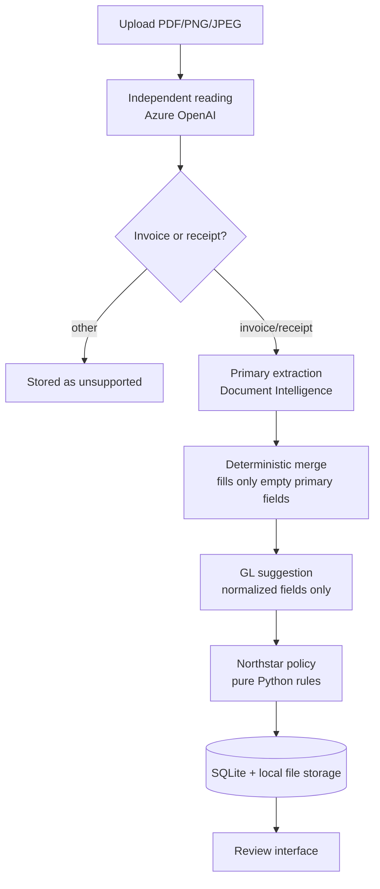

# Invoice Review

An end-to-end review workstation for supplier invoices and expense receipts, built for Northstar Facilities B.V. — a fictional Amsterdam facilities-management company whose documents arrive as PDFs, scans, screenshots, and phone photos in English, Dutch, German, or French.

Upload one document. The application recognizes what it is, extracts it twice through two independent Azure services, merges the readings deterministically, checks it against the company's finance rules, suggests a general-ledger account, and hands a finance administrator a prepared review to approve, reject, or turn into a supplier correction request.

> This repository started as a course starter containing only configuration, documentation, lockfiles, and the sample corpus — no application code. Everything under `backend/app`, `backend/scripts`, and `frontend/src` is my own build.

## The idea

A single extraction service is confidently wrong often enough to matter, and you cannot tell when from its output alone. So this application reads every document twice:

- **Azure AI Document Intelligence** (`prebuilt-invoice` / `prebuilt-receipt`) is the primary reader and stays authoritative.
- **Azure OpenAI** reads the same original file independently and produces the same normalized shape.

A deterministic merge keeps every Document Intelligence value and fills **only** its empty fields from the model. A model value can never overwrite a conflicting primary value, validate a VAT number, or decide an approval. Every field carries its provenance, so the reviewer sees exactly where each value came from and where the two readers disagreed.

Measured over the 13-document corpus:

| Run | Field accuracy | Exact documents | Policy matches | Provider failures |
| --- | ---: | ---: | ---: | ---: |
| Document Intelligence only | 168/169 — 99.4% | 12/13 | 12/13 | 0/13 |
| Hybrid (DI + independent reading) | **169/169 — 100%** | **13/13** | **13/13** | 0/13 |

The single DI-only miss is real, not synthetic: on `05-nl-missing-vendor-vat.pdf` Document Intelligence returns no `purchase_order` even though the document shows PO-4005, which then raises a spurious `purchase_order_missing` warning. The independent reading fills that exact field. `amount_due` needed the fallback on 10 of 12 invoices. That gap is the entire argument for the second reader.

## What it does

- One PDF, PNG, or JPEG per upload, 4 MB limit, type detected from the file's leading bytes rather than its name.
- Automatic invoice/receipt/other classification with strict structured output.
- Invoice supplier and customer identity, VAT IDs, dates, purchase order, currency, and totals; receipt merchant, transaction date, expense category, subtotal, VAT, and total.
- Offline EU VAT format and checksum validation via `python-stdnum` — no live VIES lookup, and the app never claims one.
- Separate deterministic invoice and receipt policies, plus duplicate detection by both exact file content and vendor/invoice-number key.
- A fixed Northstar GL catalog with a model suggestion the reviewer can override; the human owns the selection.
- Field-level corrections that atomically revalidate, with human edits marked as such and protected from re-flagging.
- Approve or reject with a final read-only state, guarded by optimistic revision checks so two tabs cannot race.
- An on-demand correction-email draft for supplier-fixable issues, offering Copy and Close. **The application never sends mail.**
- Review history with explicit deletion, so the same document can be demonstrated again.
- Live per-stage progress streamed over SSE while the pipeline runs.

## How a document flows



Each stage reports `started` / `completed` / `skipped` to the browser as it runs.

## Northstar policy

The policy is the fictional company's rulebook expressed as ordinary Python in [`backend/app/invoices/validation.py`](backend/app/invoices/validation.py). Azure supplies evidence; it does not own these rules.

**Invoices — errors block approval:** missing vendor or customer identity, missing or malformed supplier VAT, missing or mismatched customer VAT, missing invoice number, date, total, or currency, non-positive total, invalid date order, total mismatch over EUR 0.01, and duplicates. Missing PO and primary-extraction confidence below 0.80 are warnings.

**Receipts** record an already-paid expense, so no invoice number, customer VAT, PO, or due date is required. Merchant, transaction date, currency, positive total, and VAT total are required, and where subtotal and VAT are both present they must reconcile to the total within EUR 0.01.

Approval additionally requires a valid selected GL account.

## Layout

```text
backend/app/
├── api/            # HTTP concerns only: routes, typed errors, upload guards
├── pipeline/       # Ordered, observable processing steps
├── providers/      # Azure SDK types stop here
├── document_review/# Independent-reading contracts, merge, corrections
├── invoices/       # Pure deterministic finance rules
├── accounting/     # Fixed GL catalog and selection validation
├── documents/      # SQLAlchemy models, repository, file storage
├── schemas/        # Normalized invoice/receipt documents
├── correction_email/
├── service.py      # Orchestration
└── config.py       # The only backend settings boundary

frontend/src/
├── components/     # Upload, progress, preview, fields, provenance, decisions
├── lib/            # Typed API client, env boundary, shared types
└── App.tsx         # Application-level workflow

backend/scripts/    # Corpus evaluators (billable — see below)
samples/            # 13-document fictional corpus + labelled manifest
docs/               # Client brief, architecture, cost model, build log
```

Boundaries that are enforced, not aspirational: Azure SDK types never leave `providers/`, business rules in `invoices/` stay pure, `routes.py` owns HTTP, `service.py` owns orchestration, `repository.py` owns SQLite, and settings are read only through `config.py` and `frontend/src/lib/env.ts`.

## API

| Method | Path | Purpose |
| --- | --- | --- |
| `GET` | `/health` | Liveness |
| `POST` | `/api/documents/process` | Upload and process, single JSON response |
| `POST` | `/api/documents/process/stream` | Same, streaming per-stage progress (SSE) |
| `GET` | `/api/documents` | Review history, newest first |
| `GET` | `/api/documents/{id}` | One stored document with its full result |
| `GET` | `/api/documents/{id}/file` | The stored source file, served inline |
| `PATCH` | `/api/documents/{id}/corrections` | Apply corrections and revalidate atomically |
| `PUT` | `/api/documents/{id}/gl-selection` | Store the human GL choice |
| `POST` | `/api/documents/{id}/decision` | Approve or reject |
| `POST` | `/api/documents/{id}/correction-email` | Draft a supplier correction (never sent) |
| `DELETE` | `/api/documents/{id}` | Delete the record and its source |
| `GET` | `/api/gl-accounts` | The fixed Northstar catalog |

Every failure returns the same envelope with a stable code: `{"error": {"code": "...", "message": "..."}}`.

## Run it locally

**Prerequisites:** Python 3.12+, [uv](https://docs.astral.sh/uv/), Node.js 22+, pnpm 11.

```bash
cd backend  && uv sync --locked
cd ../frontend && pnpm install --frozen-lockfile
```

Configure the environment:

```bash
cp backend/.env.example backend/.env      # DI endpoint + key, AOAI endpoint, CORS origins
cp frontend/.env.example frontend/.env    # VITE_API_BASE_URL
```

Azure OpenAI authenticates through Entra, not an API key, so there is no key to paste — sign in and make sure your identity actually holds a role on the project:

```bash
az login
```

A valid token is not enough on its own. Without a project-level role assignment (Azure AI User, or Foundry Owner on the resource), every `responses.create` call returns `403` with an empty body — which is a genuinely confusing failure to debug.

Start both services:

```bash
./dev.sh          # API on :8000, web interface on :5173
```

## Evaluators

Both scripts make **real, billable Azure calls**. Run them deliberately.

```bash
cd backend

# Document Intelligence only — the baseline
uv run --locked --no-sync python scripts/evaluate_corpus.py

# Full hybrid pipeline, including the model reader
uv run --locked --no-sync python scripts/evaluate_hybrid.py
```

Pass filenames for a narrow, cheaper check. `10-de-duplicate.pdf` needs `03-de-happy-modern.pdf` in the same selection, since duplicate detection needs something to collide with:

```bash
uv run --locked --no-sync python scripts/evaluate_hybrid.py 03-de-happy-modern.pdf 10-de-duplicate.pdf
```

Each script scores extraction against `samples/manifest.json` and exits non-zero when the corpus goals are not met.

## Deployment

The [`Dockerfile`](Dockerfile) builds one image that serves both halves: the web interface is compiled with an empty `VITE_API_BASE_URL` so it calls its own origin, and FastAPI mounts the built files at `/` after the API routes are registered.

```bash
docker build -t invoice-review .
docker run -p 8000:8000 --env-file backend/.env invoice-review
```

Running on Azure Container Apps, with two things worth knowing:

- **SQLite on an Azure Files volume needs `nobrl`.** Without it, byte-range locking over SMB makes every write fail with `database is locked`.
- The container writes the database and uploaded sources under `backend/data/`. Mount that path if the records should outlive a revision.

## Verification

This project deliberately carries no committed automated test suite. It is verified by strict typing, linting, production builds, live corpus evaluators, and a manual browser walkthrough of the full story.

```bash
cd backend  && uv run --locked --no-sync ruff check app scripts
cd ../frontend && pnpm exec tsc -b --pretty false && pnpm lint && pnpm build
```

## Cost

With Document Intelligence on F0, the first 500 analyzed pages each month are free, and a full 13-document corpus run uses 14 of them. Azure OpenAI is token-metered: two calls per upload, plus a third only when a correction email is requested. A complete hybrid corpus run costs roughly **$0.30**.
